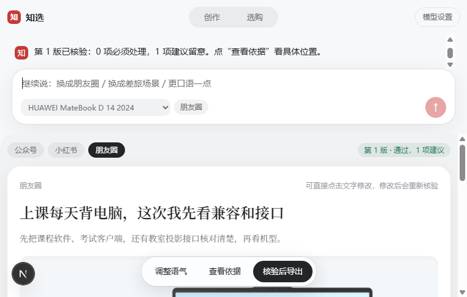

# 知选 · 选购与内容创作

从一句真实需求出发，帮助顾客选得明白，帮助门店把产品资料写成具体、有用的内容。



## 两个入口，一条业务路径

**选购端 `/consult`**：聊用途、比较产品、追问配置与接口，结合对应型号资料说明选择条件；需要创作时，将确认的需求带入独立任务。

**创作端 `/`**：先聊想法，开始创作后再展开稿件。围绕人群、场景与发布平台组织图文，支持对话改稿、直接编辑、配图、复制和下载。

- **按平台表达**：面向公众号、小红书与朋友圈，调整内容结构、语气、篇幅和图片安排。
- **产品与素材相互对应**：产品结论关联原文，图片绑定型号；优先使用已有图库，补充生成图单独标注。
- **流式对话**：回复逐步呈现，主界面聚焦内容；支持停止、历史对话和刷新恢复。
- **顺手的工作区**：对话与稿件分区可调，普通聊天保持单栏，多窗口按各自的对话地址恢复。
- **交付前检查**：修改后的稿件重新检查，关键问题处理后再导出，来源保留查看入口。
- **本地知识库随仓库提供**：产品、场景、写作方法与图片资料可直接启动读取；密钥和用户记录独立保存在本机。

## 快速开始

环境：Node.js 24、npm。模型服务使用自己的密钥。

### 1. 启动知识库

克隆仓库后，在项目根目录运行：

```sh
node scripts/start-knowledge.mjs
```

默认读取仓库中的 [本地知识库](kb/README.md)，监听 `127.0.0.1:8765`。不需要另外寻找或解压资料包。可通过 `ZHIXUAN_KB_DIR` 使用自己的资料目录，通过 `IMA_LOCAL_PORT` 改端口。

基础目录、文字检索、原文和图片读取可直接使用；可选的向量与混合检索见 [检索服务说明](scripts/rag/README.md)，需另行准备本地向量模型。

### 2. 启动应用

另开一个终端：

```sh
cd app
npm ci
npm run dev
```

打开 `http://localhost:3100`，在“设置”中配置模型网关、密钥和模型，测试连接后即可使用。创作入口为 `/`，选购入口为 `/consult`。

也可配置环境变量：

| 变量 | 用途 |
| --- | --- |
| `OPENAI_NEXT_API_KEY` | 模型服务密钥 |
| `LLM_BASE_URL` | 兼容的模型网关地址 |
| `LLM_MODELS` | 可用模型名，多个名称逗号分隔 |
| `IMA_BASE` | 资料服务地址，默认 `http://127.0.0.1:8765` |
| `ZHIXUAN_SESSION_DIR` | 可选的创作记录私密目录 |
| `ZHIXUAN_CONSULT_DIR` | 可选的选购记录私密目录 |

网页保存的模型设置优先于环境变量。密钥、会话、索引缓存和模型权重不提交到仓库。

### 3. 检查与生产运行

```sh
cd app
npm test
npm run build
npm start
```

开发和生产默认使用同一端口，应分别运行。最近一轮538项检查通过，生产构建通过；详细范围、待办及真实任务记录见 [测试记录](docs/迭代-20261023-双端路演复测.md)。

## 使用约定

价格按资料日期和具体配置表达；软件与外设适用情况按实际版本确认。产品资料、图片和教学案例均保留各自来源及使用条件。本版本面向本机使用，正式上线时需结合部署环境配置访问权限。

## 进一步了解

[作品说明书](docs/作品说明书.md) · [产品需求](docs/PRD.md) · [知识库说明](kb/README.md) · [Agent运行说明](docs/Agent运行说明.md) · [更新与测试记录](docs/迭代-20261023-双端路演复测.md)

历史说明书、示例图与验收文档保留各自日期；最新运行方式以本页为准。
