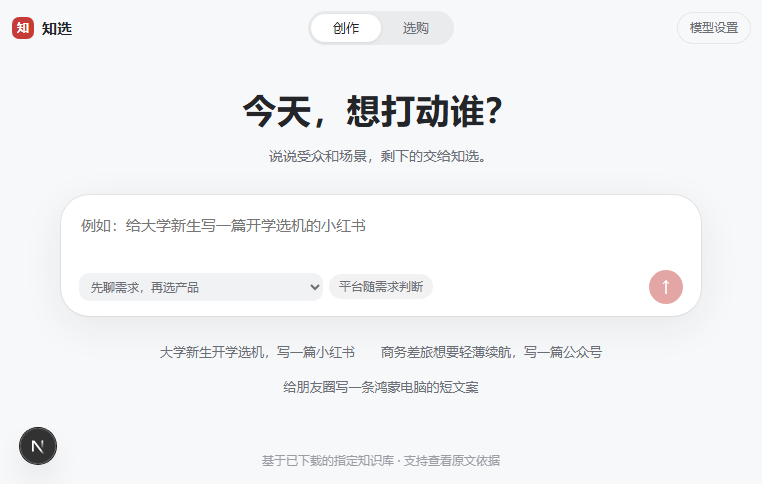

# 知选 · 创作与选购助手

面向营销人员和顾客的双端 Agent：从日常需求出发，给出有产品依据的建议，再生成适合公众号、小红书、朋友圈的图文。



## 已有能力

- **营销创作端 `/`**：选择产品、澄清受众和场景、按平台创作、独立核验、对话改稿、直接编辑、复制与导出。
- **顾客选购端 `/consult`**：从知识库 API 动态读取完整目录，现场实测 55 款产品，其中 10 款有完整资料，其余为待核实的发现卡。按任务筛选、读取对应原文并说明取舍。
- **五款营销创作产品资料隔离**：MateBook Pro S、MateBook 14 鸿蒙版、MateBook 14 酷睿 Ultra、MateBook D 14 2024、MateBook D 16 2024。不确定版本先追问；这五款是图文创作范围，不是知识库全范围。仅具备创作素材的推荐可直接带入创作端。
- **本机模型设置**：读取网关模型列表、测试连接、选择模型；留空密钥沿用本机设置。密钥仅保存在服务端的私密目录，不返回页面或导出。
- **可追溯输出**：主张绑定原文，图片绑定型号，修改后重新核验；阻断问题未处理时不能导出。
- **任务进度与恢复**：双端实时展示实际步骤，支持主动停止、刷新恢复；创作稿件、核验与最近12轮咨询保存在本机私密目录。每项任务有运行时限和模型调用上限。
- **整库检索说明**：选购端可连接混合检索，展开相关原文；最多展示50个文字片段，不能把返回数量当成知识库全部产品数量。图片路径不作为产品事实。

现场使用现有网关对 GPT-5.4 完成连接测试。网关返回的模型标识由服务商提供，不代表独立验证其底层实现。

## 快速运行

环境：Node.js 24（本机验证 24.19.0）、npm。使用自己有权访问的模型网关与知识库。

### 1. 准备授权知识库服务

本仓库不分发赛题知识库、原始资料包或凭证。请将合法取得的知识库解压到本机，目录根层应含 `P1-产品参数库`、`P2-卖点话术库` 等原始目录，保留文件名称。

在项目根目录启动只读适配器（PowerShell 示例）：

```powershell
$env:ZHIXUAN_KB_DIR = 'D:/authorized-knowledge/华为PC全板块深度知识库_v7'
node scripts/knowledge-server.mjs
```

默认仅监听 `127.0.0.1:8765`，支持健康检查、完整目录、分页字面搜索和按编号读取原文。可通过 `IMA_LOCAL_PORT` 改端口。可选的全库混合检索源码见 [scripts/rag](scripts/rag/README.md)，适配器连接方式见[知识库运行说明](docs/知识库运行说明.md)。未配置混合检索时会明确降级，不冒充已完成整库搜索。

### 2. 启动网页

```powershell
cd app
npm ci
npm run dev
```

浏览器打开 `http://localhost:3100`，点击“模型设置”，填入自己的网关和密钥，读取模型列表、测试后保存。连接请求会发送给指定网关。空密钥可沿用当前服务端配置。

服务端也接受环境变量：

| 变量 | 用途 |
| --- | --- |
| `OPENAI_NEXT_API_KEY` | 模型网关密钥 |
| `LLM_BASE_URL` | 网关地址，兼容 `/v1` 或完整 `/v1/chat/completions` |
| `LLM_MODELS` | 实际可用的模型名，多个名称逗号分隔 |
| `IMA_BASE` | 知识库服务，默认 `http://127.0.0.1:8765` |
| `ZHIXUAN_SESSION_DIR` | 可选的创作会话保存目录，默认 `app/data/private/sessions`；需保持私密 |
| `ZHIXUAN_CONSULT_DIR` | 可选的咨询保存目录，默认 `app/data/private/consultations`；需保持私密 |

网页保存的模型设置优先于环境变量，位于 `app/data/private/`，已排除提交。

### 3. 验证与生产运行

```powershell
cd app
npm test
npx tsc --noEmit
npm run build
npm start
```

知识库集成测试需要上面的授权资料服务。其余测试使用网络替身，不消耗模型额度。生产运行与开发运行使用同一默认端口，请分别启动。

## 产品文档

- [作品说明书](docs/作品说明书.md) · [PDF](output/pdf/知选-作品说明书.pdf)
- [产品需求](docs/PRD.md) · [开发计划](docs/开发计划.md) · [开发日志](docs/开发日志.md)
- [演示脚本](docs/演示脚本.md) · [验收记录](docs/统筹检查记录.md) · [提交清单](docs/提交材料清单.md)
- [复赛打磨计划](docs/复赛打磨计划.md) · [复赛验收记录](docs/复赛验收记录.md) · [Agent运行说明](docs/Agent运行说明.md)

现有PDF与首页示例图是初赛交付，不代表复赛新增功能的完整验收。

## 当前边界

实际生成使用“本地已下载知识库”，不冒充实时 ima 在线读取。历史价格必须保留日期、配置与条件，不能当当前到手价。D 16 只有两张已接入产品图，小红书素材数量不足时需换平台或补充授权素材。图片索引不等于实际画面，未人工复核的图使用中性图注。

咨询端验证推荐编号是否属于对应产品；它不能替代对每句话的人工判断。关键软件需按真实版本与工作流程试用。热点联动、实时优惠、自动发布、账号与长期画像尚未完成。

双端会话保存在本机私密目录，浏览器只保存恢复编号；刷新可恢复，服务重启后未完成任务标为中断，不自动重跑。旧版浏览器咨询记录仅供只读查看，不自动导入新会话。本版本面向单机运行，尚无账号权限、跨设备账号历史和跨进程任务协调。源码发布不代表已经完成魔搭提交或公网应用部署。
