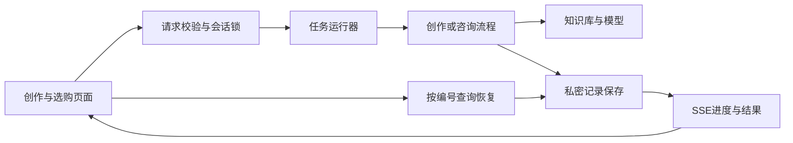

# Agent运行说明

更新：2026-10-19。创作端与选购端同属3100网页服务，知识库服务独立运行。

## 流程与分工

前端负责角色切换、真实进度、停止确认、资料查看和恢复后的展示；知识库端负责目录、检索、原文与来源核对；应用后端负责输入校验、历史管理、任务预算、取消、隔离与保存。两端复用运行器及事件读取逻辑，各自保留创作核验和选购比较的业务流程。恢复只读保存结果，不自动触发模型。

## 用户流程

创作端可以自由提问、讨论策划、请求写作或改稿，由模型结合动态目录理解任务并选择产品。用途或发布平台不足时再追问，不要求先选五款电脑。助手按实际执行顺序展示需求理解、资料读取、写稿和核验。资料有限或缺图时可先出说明边界的文字草稿，不能拼接其他型号图片；只有当前版本完成检查并满足导出条件才能导出。模型按结构化JSON整包返回，本版不是逐token生成。

“停止任务”先提交停止请求，再以任务结束事件或恢复查询确认。停止和超时保留最近成功保存的内容，不把未完成的核验标成成功。关闭页面不会等同主动停止，服务仍继续保存；重新进入后按原编号恢复，不重新生成。

选购端也提供SSE步骤、调用摘要、停止与服务端记录恢复。先理解用途、读取目录、检索资料、核对候选，再展示结构化方案和原文。选定具备素材的产品后，可以带入独立创作。旧版浏览器对话只读展示，不混入新咨询的服务端历史。

两端均可打开模型设置。若模型密钥额度不足，显示明确原因并保留已保存的问题，不继续轮换模型反复扣费。连接测试成功仅表示短请求可用，不能替代完整任务验收。

## 接口约定

| 接口 | 行为 |
| --- | --- |
| `POST /api/agent` | 原消息或编辑请求，`Accept: text/event-stream`返回SSE；不指定时保留NDJSON兼容。 |
| `GET /api/agent?sessionId=...` | 返回最近已保存稿件、对话、忙碌状态、中断状态和可选run；不触发生成。 |
| `POST /api/agent/cancel` | `{sessionId,runId}`；202表示收到请求，409表示任务结束或编号已变化，需要恢复查询。 |
| `GET /api/export?sessionId=...` | 任务忙碌或当前稿未完成核验时拒绝导出；调用留痕仅本会话最近500条。 |
| `POST /api/consult` | 新协议为`{sessionId,message}`，接受SSE，默认兼容NDJSON；无sessionId的旧messages请求保留JSON响应。 |
| `GET /api/consult?sessionId=...` | 返回最近12轮问题与已保存回答、busy、interrupted、updatedAt、run及可选error；不生成新回答。 |
| `POST /api/consult/cancel` | `{sessionId,runId}`；202只表示收到请求，最终结果以事件或恢复查询为准。 |

SSE事件含`id: runId:seq`、`event: type`、`data: JSON`和空行。JSON保留原事件字段并附运行编号、递增序号与时间。创作端包括run、step、tool、need、clarify、notice、draft、check、error、done；选购端包括run、step、tool、answer、error、done。连接保活heartbeat可忽略。tool只显示资料或模型调用的安全摘要，不含密钥、网关和隐藏推理。

run状态为running、completed、failed、cancelled、timed_out、interrupted。done表示本次执行结束，completed也可能只是澄清完成，不表示生成或核验成功。页面按当前稿件及其检查报告独立判断。

本版通过GET快照恢复，不支持Last-Event-ID完整历史重放。停止只匹配同一会话的当前运行编号，不能停止后续新任务。

## 执行保护与保存

创作单次默认5分钟、最多16次模型请求；咨询单次默认3分钟、最多8次。模型切换与格式重试均计入预算，前端不能提高预算。模型与资料请求继承停止信号；任务副本与已保存会话隔离，迟到响应不能写回新任务。服务重启会把磁盘上未完成记录标为中断。两端即使使用相同会话编号，也使用独立的任务空间和保存目录。

保存使用临时文件后原子替换；失败会退回最后实际保存的记录，不把内存新稿伪装成已保存。如果结束保存失败留下忙碌记录，后续恢复、提交或导出会核对任务是否仍在运行；任务已退出时，将中断状态成功保存后解除锁。存储仍不可写则明确报错，不伪报空闲。Windows大小写不同的会话编号共用锁与文件。消息超过2000字、单项编辑超过6000字会明确拒绝，正文不会静默截断。

创作会话默认保存到`app/data/private/sessions`，或`ZHIXUAN_SESSION_DIR`指定目录；咨询保存到`app/data/private/consultations`，或`ZHIXUAN_CONSULT_DIR`指定目录。咨询保留最近12轮和500条资料调用，客户端只能发送新问题，历史以服务端为准。这些目录含用户需求、产品片段与稿件，不上传。当前不提供账号、多进程队列或跨设备恢复，不能直接将本机原型当公开多人服务。

## 验证边界

离线测试覆盖SSE边界、旧协议兼容、取消、超时、调用预算、迟到响应、保存回滚与会话隔离。浏览器模拟接口验收验证交互，不等于真实知识库与模型完整联调。具体实测记录见[复赛验收记录](复赛验收记录.md)。
