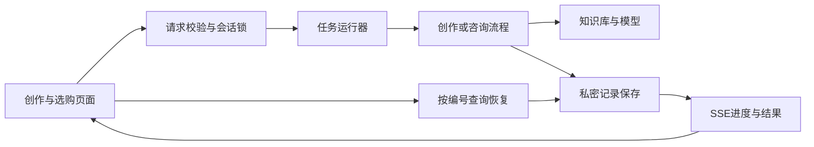

# Agent运行说明

更新：2026-10-21。创作端与选购端同属3100网页服务，知识库服务独立运行。

## 2026-10-21 用户任务与工具复验

默认对话及选购现已在用户询价时读取同产品公开价格卡；明确区分型号、屏幕、容量、颜色、否定条件和历史日期，无对应配置不套用其他款。双端已接实际互联网搜索，可读取允许范围内的官方产品正文，来源链接可点击。官网参考价与商城具体成交报价分别表达；目前后者仍未取得。非询价不把隐藏价格带进回复。

“先查再写”会继续进入原有稿件、图库及内容检查流程；“不写价格”不再触发报价。咨询失败后的追问仍带用户原问题。窄窗口已实际检查发送、改稿、导出操作，完整资料可从来源区打开。

本轮最终461项检查通过；同一18句真实对话最终两轮价格6/6、联网搜索及正文读取6/6，内部措辞0/18；另有3次真实组合任务与独立故障注入。中间失败全部保留，具体范围、证据与未解决项见[用户任务与工具报告](迭代-20261021-用户任务与工具.md)。实际使用仍有创作隐含效果判断、商城动态报价、ima在线同步等限制，不以测试总数宣称产品所有功能均已完成。

## 2026-10-21 可靠性验收

主张未确认且未被具体问题覆盖时，执行一次仅针对遗漏项的补查；补查仍缺项不能形成通过报告。普通建议独立处置，已确认ID与已处理ID分别记录。旧版报告缺少完整处理记录时，页面保留草稿且导出拒绝，不把旧`pass`当新协议通过。

明示的阿拉伯数字正文上限或范围，在新稿/改稿交付前实际计字，超出时仅补救一次，仍不满足则报错；改稿不会用不合格新内容覆盖原稿。纯文字改稿默认保持图库ID、顺序、位置和图注，明确请求改图时才允许调整。Windows原子替换遇瞬时EPERM最多等待85ms重试，其他错误或耗尽仍回滚。

原生DeepSeek配置下，带产品证据的普通问答优先Pro低思考并保留原模型回退；普通聊天、写作与核验维持原模式，其他网关不改。未展示隐藏推理。改变写作/核验模型或堆提示词的试验未达标，均未作为有效方案部署。

380项自动检查、生产构建、32项模拟流式界面检查和2项历史报告浏览器检查通过。真实HTTP网页中，聊天、咨询、写稿、同会话改稿、移动端、导出、刷新恢复已验收，聊天/咨询/新稿分别收到21/14/8条可见流式快照。当前3100与8765仅监听127.0.0.1；知识库1522份文件。混合检索服务不计入本轮恢复声明。完整失败记录、评测标签审计与成功证据见[本轮报告](迭代-20261021-主张覆盖.md)。

## 2026-10-20 配图补充设计与实施计划

用户已授权接入 Qwen，并明确现有图库优先。采用独立辅助素材，不让生成图替代真实产品图或充当产品事实证据。图库读取失败直接保留现有稿件，不把故障当成缺图触发生图。

本轮只在已有稿件、用户明确要求补图时执行：先重新读取本型号图库，由规划器选择合适的现有图；已有选图适合时直接复用，不重复插图。没有合适的场景图且用户允许生成时，调用 Qwen，一次只生成一张不含设备、品牌、功能界面的环境插画；默认写稿不额外调用生图。生成图标为“AI 生成场景图”，不称为官方图或已人工复核图片。

补图也生成新版稿件并重新检查，素材绑定当前型号、稿件版本和文件摘要。真实图库图片继续走原图片与事实约束，生成辅助图不补足缺少真实产品图的缺口，合计张数不超过平台限制。改正文时由复用判断比较新旧用途，语气、纠错或精简但场景不变时可把同一文件绑定新版；换场景、换产品或数量冲突时不沿用，不自动重新生成。创建描述仅作使用意图参考，不当成画面事实证明。

实施顺序：

1. 独立 Qwen 配置与图片生成模块：专用密钥，只请求官方接口；有界读取、取消、内容校验、不可覆盖文件和安全错误。不自动重试可能已计费的生成请求。
2. 对话与配图规划：明确用户补图意图，图库优先，读取失败不生成；生成后与新版稿件一起保存并重新检查，任何失败保留原稿。
3. 页面、恢复、文件接口与导出：来源清楚，使用当前版本地址；生成文件通过受会话约束的独立接口读取，支持实际下载，不依赖会过期的上游链接。
4. 验证：图库命中不生图、禁止生成时不调用、图库故障不生图、取消迟到无提交、改稿版本隔离、文件摘要变化拒绝、恢复和真实生成下载。真实调用与模拟测试分别记录。

配置读取本机私密文件 `app/data/private/image-settings.json`，也支持独立的 `QWEN_IMAGE_API_KEY`；不复用或覆盖文字模型密钥。生成素材也只写入私密目录，不进入 Git、公开文档或客户端配置。

## 流程与分工

前端负责角色切换、真实进度、停止确认、资料查看和恢复后的展示；知识库端负责目录、检索、原文与来源核对；应用后端负责输入校验、历史管理、任务预算、取消、隔离与保存。两端复用运行器及事件读取逻辑，各自保留创作核验和选购比较的业务流程。恢复只读保存结果，不自动触发模型。

## 用户流程

创作端可以自由提问、讨论策划、请求写作或改稿，由模型结合动态目录理解任务并选择产品。用途或发布平台不足时再追问，不要求先选五款电脑。助手按实际执行顺序展示需求理解、资料读取、写稿和核验。资料有限或缺图时可先出说明边界的文字草稿，不能拼接其他型号图片；只有当前版本完成检查并满足导出条件才能导出。模型按结构化JSON整包返回，本版不是逐token生成。

“停止任务”先提交停止请求，再以任务结束事件或恢复查询确认。停止和超时保留最近成功保存的内容，不把未完成的核验标成成功。关闭页面不会等同主动停止，服务仍继续保存；重新进入后按原编号恢复，不重新生成。

选购端也提供SSE步骤、调用摘要、停止与服务端记录恢复。先理解用途、读取目录、检索资料、核对候选，再展示结构化方案和原文。选定具备素材的产品后，可以带入独立创作。旧版浏览器对话只读展示，不混入新咨询的服务端历史。

两端均可打开模型设置。若模型密钥额度不足，显示明确原因并保留已保存的问题，不继续轮换模型反复扣费。连接测试成功仅表示短请求可用，不能替代完整任务验收。

## 接口约定

| 接口 | 行为 |
| --- | --- |
| `POST /api/agent` | 原消息或编辑请求，`Accept: text/event-stream`返回SSE；不指定时保留NDJSON兼容。 |
| `GET /api/agent?sessionId=...` | 返回最近已保存稿件、对话、忙碌状态、中断状态和可选run；不触发生成。 |
| `POST /api/agent/cancel` | `{sessionId,runId}`；202表示收到请求，409表示任务结束或编号已变化，需要恢复查询。 |
| `GET /api/export?sessionId=...` | 任务忙碌或当前稿未完成核验时拒绝导出；调用留痕仅本会话最近500条。 |
| `POST /api/consult` | 新协议为`{sessionId,message}`，接受SSE，默认兼容NDJSON；无sessionId的旧messages请求保留JSON响应。 |
| `GET /api/consult?sessionId=...` | 返回最近12轮问题与已保存回答、busy、interrupted、updatedAt、run及可选error；不生成新回答。 |
| `POST /api/consult/cancel` | `{sessionId,runId}`；202只表示收到请求，最终结果以事件或恢复查询为准。 |

SSE事件含`id: runId:seq`、`event: type`、`data: JSON`和空行。JSON保留原事件字段并附运行编号、递增序号与时间。创作端包括run、step、tool、need、clarify、notice、draft、check、error、done；选购端包括run、step、tool、answer、error、done。连接保活heartbeat可忽略。tool只显示资料或模型调用的安全摘要，不含密钥、网关和隐藏推理。

run状态为running、completed、failed、cancelled、timed_out、interrupted。done表示本次执行结束，completed也可能只是澄清完成，不表示生成或核验成功。页面按当前稿件及其检查报告独立判断。

本版通过GET快照恢复，不支持Last-Event-ID完整历史重放。停止只匹配同一会话的当前运行编号，不能停止后续新任务。

## 执行保护与保存

创作单次默认5分钟、最多16次模型请求；咨询单次默认3分钟、最多8次。模型切换与格式重试均计入预算，前端不能提高预算。模型与资料请求继承停止信号；任务副本与已保存会话隔离，迟到响应不能写回新任务。服务重启会把磁盘上未完成记录标为中断。两端即使使用相同会话编号，也使用独立的任务空间和保存目录。

保存使用临时文件后原子替换；失败会退回最后实际保存的记录，不把内存新稿伪装成已保存。如果结束保存失败留下忙碌记录，后续恢复、提交或导出会核对任务是否仍在运行；任务已退出时，将中断状态成功保存后解除锁。存储仍不可写则明确报错，不伪报空闲。Windows大小写不同的会话编号共用锁与文件。消息超过2000字、单项编辑超过6000字会明确拒绝，正文不会静默截断。

创作会话默认保存到`app/data/private/sessions`，或`ZHIXUAN_SESSION_DIR`指定目录；咨询保存到`app/data/private/consultations`，或`ZHIXUAN_CONSULT_DIR`指定目录。咨询保留最近12轮和500条资料调用，客户端只能发送新问题，历史以服务端为准。这些目录含用户需求、产品片段与稿件，不上传。当前不提供账号、多进程队列或跨设备恢复，不能直接将本机原型当公开多人服务。

## 验证边界

离线测试覆盖SSE边界、旧协议兼容、取消、超时、调用预算、迟到响应、保存回滚与会话隔离。浏览器模拟接口验收验证交互，不等于真实知识库与模型完整联调。具体实测记录见[复赛验收记录](复赛验收记录.md)。
