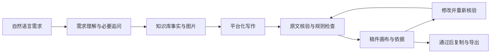

# 知选：华为PC图文创作Agent

版本：2026-10-18现场收尾版。营销创作端与顾客咨询端已接通，模型设置已使用现有网关真实验证 `gpt-5.4`；首页、咨询页已做真实浏览器操作。动态全目录咨询正在补充，本轮最终统一验收与提交由主线程完成。本文区分已验证能力、历史缺陷与待验收事项。

## 一、解决什么问题

面向华为PC营销人员、门店导购和内容运营，把“我要对谁说、对方正在做什么”转成有资料依据的图文。创作不从堆参数和促销口号开始，而是先说明具体任务、选择理由、限制和需要核对的事情，再形成适合平台的表达。

例如，大一新生选机，先核对课程软件和教室外设；差旅用户选机，先关注携带、会议连接和企业应用。相同产品在不同场景中应有不同的叙述顺序，也应说明不适合直接下结论的地方。

营销图文链路已接通五款：MateBook Pro S、MateBook 14 鸿蒙版、MateBook 14 酷睿 Ultra、MateBook D 14 2024、MateBook D 16 2024，分别读取对应事实、场景与图片，参与核验。**五款是已接通营销图文链路的范围，不是知识库或选购需求的全范围。**

主线程本轮目录核查发现：目录 API 有1522个文件；`P1/07` 扩展产品有55条发现条目，加索引共56项；`P1/01`、`P1/02` 有10份完整产品事实。发现条目、完整事实和具备图片／场景／核验的营销链路是不同层次，不能互相替代。动态 catalog 与咨询端全目录发现、按需读取原文正在新增，**本轮待验收**，最终覆盖数字和运行状态由主线程补充。

## 二、已实现的主要流程

1. 用自然语言说明人群、情境和发布平台；必要信息缺失时追问。
2. 从本地知识库服务读取产品事实、限制、相关场景卡和图片索引；保留来源类型。
3. 自研流程组织证据与图片清单，再调用模型生成标题、正文、行动建议和配图方案。
4. 使用独立核验步骤对照原文，并结合图片数量、引用编号、版本条件和宣传表述等规则检查。
5. 用户通过对话或画布修改，修改后重新核验。
6. 当前版本满足导出条件时，可复制文案或下载含依据、图片信息与核验报告的JSON。

这是应用自行编排的创作流程；知识库提供依据，写作、检查和改稿由应用组织完成。

顾客咨询端 `/consult` 已可围绕任务、预算和必用软件讨论候选与取舍，并将选定产品与场景带入创作端；首页与咨询页已真实操作。全目录发现与按需读原文仍在本轮验收范围内，不能据现有页面操作就宣称全部目录均已验证。

本机模型设置支持读取网关模型列表、测试连接与保存；主线程已真实验证三项均返回200，当前选择 `gpt-5.4`。密钥只保存在服务端本机私密目录，页面不回显，未纳入公开源码。模型标识来自现有网关，不额外承诺其底层实现。

## 三、平台与内容形式

| 平台 | 内容设计 | 配图要求 |
| --- | --- | --- |
| 小红书 | 具体问题切入，短段落、选择清单和可回答的问题 | 3–6张 |
| 公众号 | 场景、取舍、核对清单，适合较完整论证 | 2–4张 |
| 朋友圈 | 一个问题、一个理由、一个后续动作 | 1–3张 |

图片来自指定资料的图片目录和索引；不能用生成的产品图补缺。图注仍需与实际画面核对，文件名或索引标签不能替代看图。

D 16 当前接入两张产品图；素材不足以满足小红书数量要求时，应换平台或补充授权素材，不能拼入其他型号图片。

产品事实绑定原文依据。软件兼容性需要系统和应用条件，不能由“具备接口或功能”推导成所有工作流程都可用。价格资料是有日期的快照，不能当实时到手价。没有活动依据时不编造优惠、最后一天或补贴叠加。

## 四、实际架构与提示词

前端提供营销创作与顾客咨询两个入口，采用对话推进任务、稿件按需展开的方式。后端包含需求理解、证据选取、生成、核验和版本管理。知识库服务提供原文和图片；本地增强检索是独立能力，目前主创作不依赖它。动态目录发现与按需阅读正在补充，不能把发现条目直接当作已完成核验的营销资料。

实际执行提示词在 `app/lib/prompts.ts`，包含八个模块：角色与任务、场景理解、平台规则、知识库约束、图片规则、生成要求、核验规则、合规规则。任务提示与独立核验提示在 `app/lib/agent.ts`。最终提交应附这两份实际代码，避免用较早的规划提示词代替。

朋友式推荐的写作技能在 `.claude/skills/friend-recommend-content/`，内容窗口已完成更新及两平台文字试写。公开搜索和部分公众号正文读取已有独立入口，小红书MCP尚未接通；这些研究能力尚未接入创作主流程，也尚未证明完整技能已接入运行时提示词。具体边界见 `协作/内容收尾交接.md`。

`output/content-demo/` 是独立图文技能示例，包含公众号与小红书正文、图卡和浏览器预览，可用于介绍内容与排版方法；它不是主应用生成的结果，不计入主应用真实运行成果。

## 五、真实运行结果与验证

以下登记本机已保存的主应用真实导出，同时保留失败候选的原貌；不把设计样图、独立技能示例或单纯运行日志当成主应用成果。

| 结果 | 场景与平台 | 实际状态 |
| --- | --- | --- |
| `output/final-runs/run-final-gzh-travel.json` | 商务差旅／公众号 | 可用优秀结果：版本1，3张图，26条主张，73条依据；2026-10-18 16:44:49（北京时间）核验pass、0问题；三张图注已复核 |
| `output/final-runs/run-a3-student.json` | 大学新生选机／朋友圈 | 旧缺陷候选：版本2，2张图，5条主张，16条依据；16:09:57核验pass，但人工复核发现“人物创拍”图注与画面不符；不计为优秀结果 |
| `output/final-runs/run-d1-xhs.json` | 商务差旅／小红书 | 旧缺陷候选：版本1，3张图，14条主张，46条依据；16:26:58核验pass但有1条防窥效果条件警告，且有图片描述问题；不计为优秀结果 |

主线程已验证上一轮125项测试与类型检查全部通过，模型设置的列表／测试／保存均真实返回200；首页与咨询页已做真实浏览器操作。动态全目录咨询是之后新增的本轮待验收事项，最终统一重跑由主线程执行；这里不将此前检查当作新增功能的最终验收。

已保存稿件的图片及事实来源均标注为“本地已下载知识库”，不是实时ima在线响应。导出中的 `imaCalls` 为服务级近期记录（`service-recent`），可能包含其他会话调用，不是本会话调用清单；本稿依据应看 `claims`、`evidence` 和 `images` 的对应关系。

公众号结果的三张图分别采用合盖外观、多人桌边使用电脑的场景、无人物的紫色机身侧面描述；场景图不被当作具体协同功能的证明。旧a3、d1的缺陷记录仍见 `output/final-runs/图片与结果复核.md`，原始导出不改写；`output/final-runs/manifest.json` 将公众号结果登记为可用，旧两项仍为非最终就绪。

**目前确认一组主应用优秀结果，另两组仅作为缺陷候选留存，不能合计为三组优秀结果。**

## 六、如何操作

按根目录README启动服务后，打开本机3100端口首页：

1. 输入：“给准备开学的大学新生和家长写一篇小红书，产品是HUAWEI MateBook Pro S，先核对课程软件，再解释便携与接口的取舍，不写价格。”
2. 回答必要追问，等待实际步骤与稿件出现。
3. 打开依据面板，检查版本条件、资料来源和图片；如有问题，按提示修改。
4. 输入：“开头更像朋友提醒，减少推销感，保留软件兼容与接口限制。”等待新版本重新核验。
5. 导出当前通过版本，保存正文和JSON。图片按选用原文件与图注另行归档。

咨询演示可从 `/consult` 输入任务、预算和软件需求，再把选择与场景带到创作端。动态全目录发现与按需读原文的最终演示，以主线程补充的验收记录为准。

当前浏览器刷新无法保证回到原会话，服务重启会丢失内存会话。生成成功后先导出，录屏前避免重启。

## 七、部署与边界

安装与运行见根README，知识库恢复见 `协作/后端收尾交接.md`。模型凭证由部署者提供，不进入源码、说明书和录屏。

当前边界：

- 五款是已接通的营销图文范围，不是知识库全范围；全目录咨询发现与按需阅读本轮待验收。资料不足时说明缺项，不替换成别的型号。
- 当前可用结果来自本地已下载知识库；不承诺实时热点、实时优惠或实时ima在线写稿。
- 首页与咨询页已做真实浏览器操作；新增目录能力及本轮最终统一重跑仍待主线程补回执。
- 公众号优秀结果三张图注已复核；旧a3、d1的缺陷保留，不由新结果通过推断旧结果已修复。
- 会话未持久保存，暂无完整用户账号与长期画像。
- 连续录屏、魔搭提交、公网访问条件与最终构建／页面统一复验，以主线程最终回执为准。
- 核验用于辅助发现问题，不承诺零错误；资料日期、来源和配置条件仍需保留。

## 八、最终提交材料

按赛题准备GitHub源码与运行说明、魔搭作品页面、作品说明书。初赛至少一组可辨认真实运行结果；复赛增加不少于三组、覆盖至少两类场景和两个平台的结果，以及连续真实运行录屏。详见 `docs/提交材料清单.md`，最终以原始赛题与现场通知为准。

计划提交GitHub仓库 `CryptoDuzey/zhixuan`。公开源码与运行说明，不上传原始知识库、密钥、本机私密设置或 `output/final-runs/` 原始运行导出。源码推送、魔搭作品页面和公网部署是不同事项，完成状态以主线程最终回执为准；本文不声称已经全部发布或提交。
